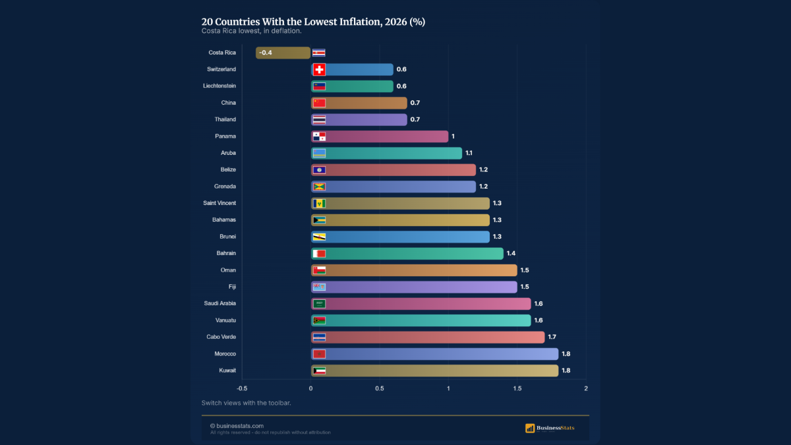

# 🌍 Global Inflation Dashboard 2026

A responsive, interactive visualization of the **20 countries with the lowest inflation rates in 2026**, based on a supplied businesstats infographic.



## Features

- 📊 Colorful horizontal bar chart with country flags
- 🔎 Instant country search
- ↕️ Sort by inflation rate or country name
- 📱 Responsive layout for desktop and mobile
- 📈 Summary cards: country count, minimum, maximum, and average
- ♿ Keyboard-accessible controls and reduced-motion support
- 🌓 Persistent dark/light theme toggle
- 🎛️ Rate-category filtering and visible-result counter
- 📥 Export the currently filtered/sorted data to CSV
- ✨ Hover highlights and polished controls
- ⚡ Zero dependencies — plain HTML, CSS, and JavaScript

## Getting started

1. Download or clone this repository.
2. Open `index.html` in your browser.
3. Search or sort the data to explore the results.

No installation, server, or API key is needed.

## Project structure

```text
global-inflation-dashboard-2026/
├── index.html                 # Page structure
├── style.css                  # Responsive dark-theme styles
├── script.js                  # Dataset and interactive chart
├── reference-infographic.png  # Supplied reference image
├── LICENSE                    # MIT License
└── README.md                  # Project documentation
```

## Data notes

All figures are **transcribed from the user-provided infographic**, titled *“20 Countries With the Lowest Inflation, 2026 (%)”* and branded businesstats. The numbers are not fetched from a live API and have not been independently verified. The graphic lists Costa Rica at **−0.4%** and Kuwait and Morocco at **1.8%**. The negative figure is represented as a bar magnitude with its signed label.

If using this dashboard for economic analysis, verify the reference period, methodology, and latest estimates against an authoritative source.

## Deploy with GitHub Pages

1. Push these files to a public GitHub repository.
2. Open **Settings → Pages** in that repository.
3. Under **Build and deployment**, choose **Deploy from a branch**.
4. Select the `main` branch and `/ (root)` folder, then save.
5. Wait for GitHub Pages to publish the site.

## Customization

Edit the `countries` array in `script.js` to change the data. Edit `style.css` to customize the theme.

## License

MIT — see [LICENSE](LICENSE).

## Source and attribution

## 📚 Data Source & Attribution

The inflation statistics presented in this dashboard are based on publicly available information published by **businesstats.com**.

The original research, statistical data collection, and analysis are credited to their respective sources.

### 💻 Project Development

This project was created as part of my personal learning journey to explore frontend development and data visualization.

The dashboard was developed using HTML, CSS, and JavaScript, with AI-assisted coding support.

### ⚠️ Disclaimer

- This project is intended for educational and portfolio purposes only.
- The original statistical research and data do not belong to me.
- The dashboard is an independent visualization project.
- The data should not be considered real-time or independently verified.
- This project is not affiliated with or endorsed by businessstats.com.
